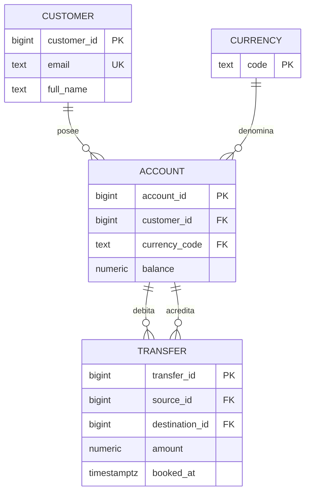
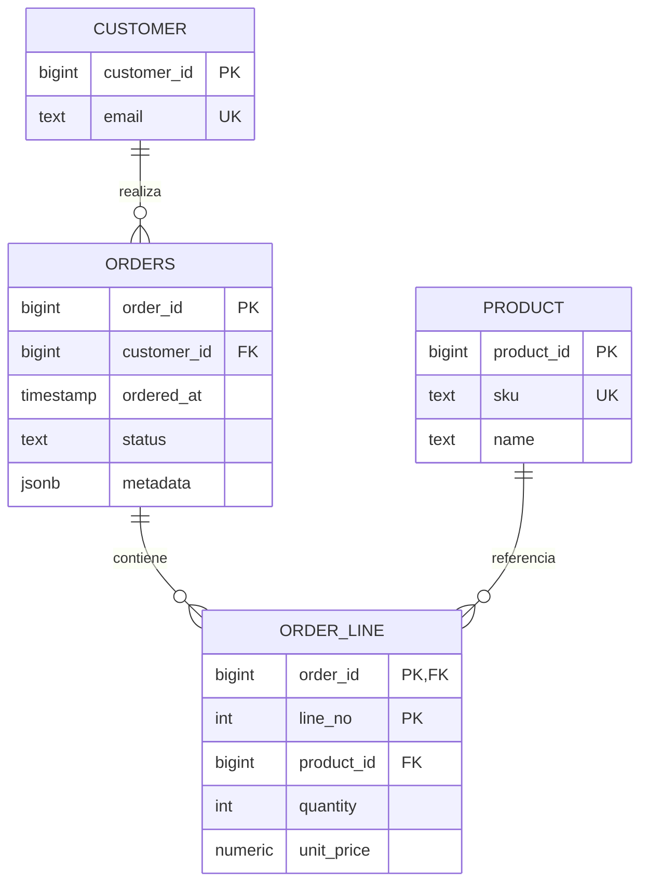
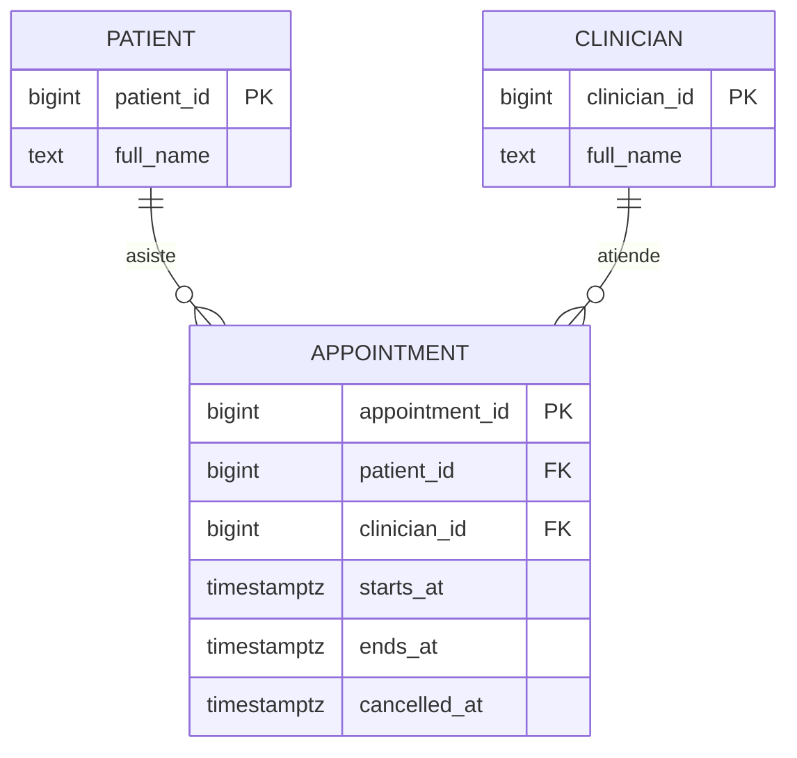

# Modelos relacionales

## Core bancario

- **1FN.** Cada cuenta guarda un cliente, una moneda y un saldo. Cada transferencia registra por separado su cuenta de origen y su cuenta de destino.
- **2FN.** Las claves candidatas son simples. El importe y la fecha dependen del identificador de la transferencia.
- **3FN.** El nombre y el correo dependen del cliente. La moneda reside en la cuenta y el procedimiento verifica que las dos cuentas compartan moneda. El saldo es un estado mantenido transaccionalmente que debe actualizarse junto con el registro de transferencia. El laboratorio admite saldos iniciales y transferencias internas en una sola moneda.

## Comercio electrónico

- **1FN.** Una fila por línea evita grupos repetidos de productos. Cada metadato JSONB es parte de un documento de captura a nivel de orden, con claves escalares en la semilla. Si una clave adquiere reglas relacionales o se convierte en una entidad consultada por derecho propio, conviene extraerla al esquema.
- **2FN.** Producto, cantidad y precio pactado dependen de la clave completa de línea `(order_id, line_no)`. La fecha y el cliente dependen solo del pedido y se guardan en la cabecera.
- **3FN.** El SKU y el nombre dependen del producto. El precio pactado es un hecho de la línea y puede variar entre pedidos del mismo producto. El correo depende del cliente.

## Agenda clínica

- **1FN.** Cada fila representa una cita y guarda un instante por extremo del intervalo.
- **2FN.** Cada relación tiene clave simple. La fecha de cancelación y los extremos dependen de la cita.
- **3FN.** Los datos personales viven en sus entidades de origen. La duración se deriva al consultar. Dos restricciones de exclusión GiST protegen las citas activas por paciente y por profesional. El intervalo semiabierto `[inicio, fin)` permite citas contiguas y la cancelación libera el espacio.
